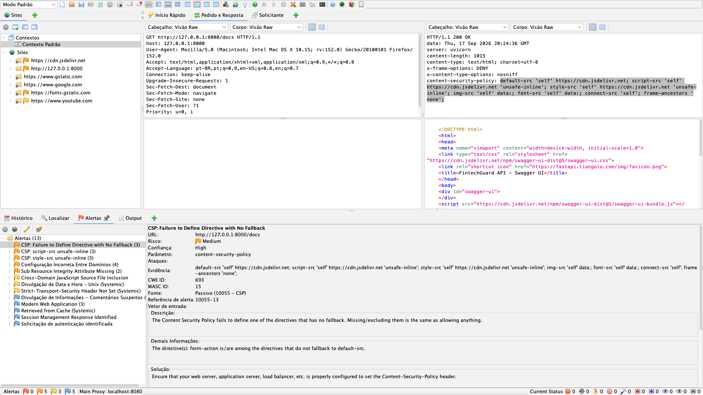
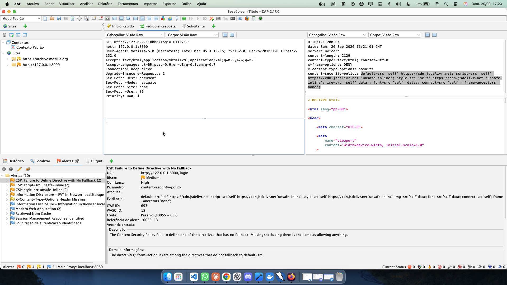
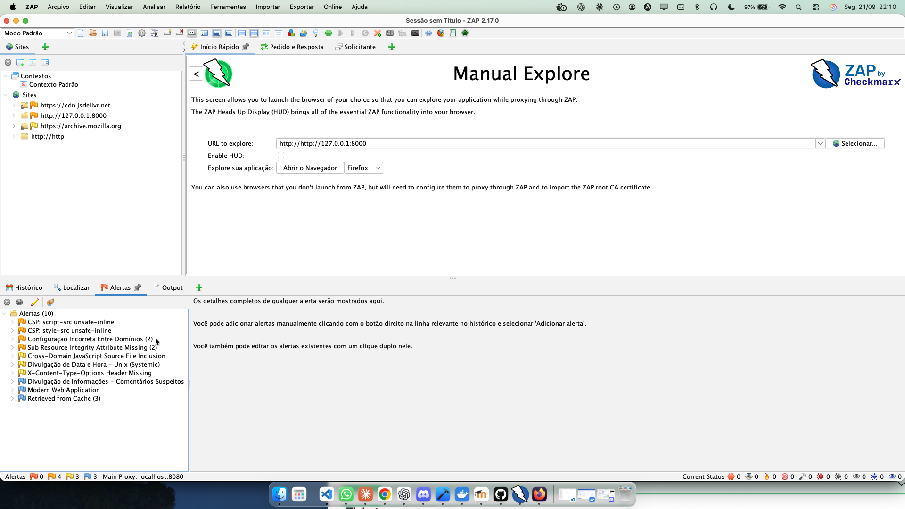
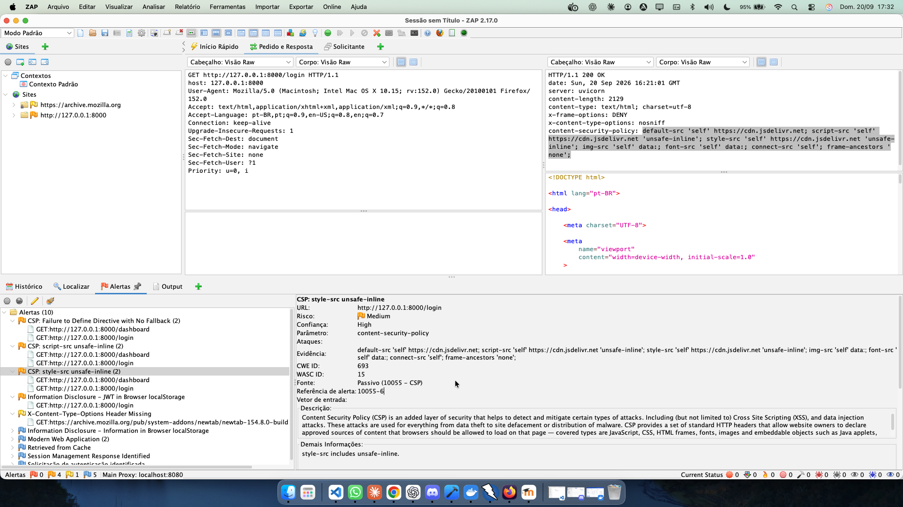
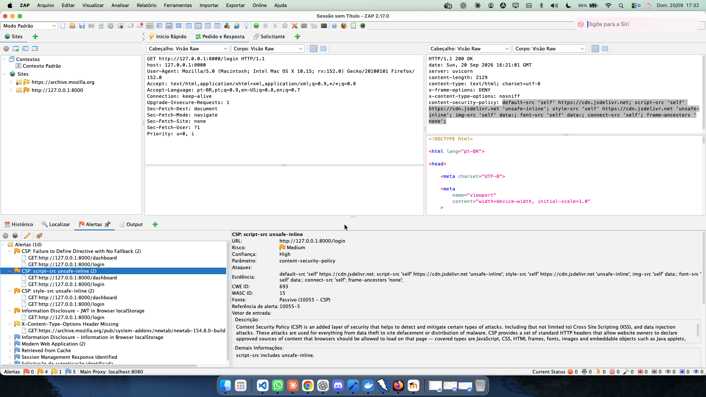
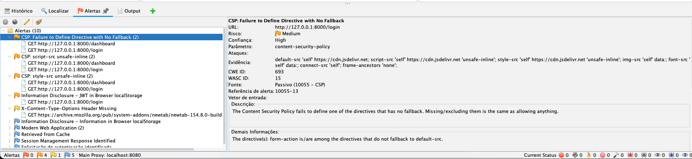

# FintechGuard — README TP3

## 1. Visão geral

O **FintechGuard** é um projeto acadêmico voltado à segurança digital e à proteção de dados no contexto de serviços financeiros. O projeto busca desenvolver uma aplicação web com foco em conscientização sobre segurança, privacidade e proteção das informações dos usuários.

Este documento registra as implementações realizadas no TP3, incluindo a criação dos templates HTML, a configuração de testes automatizados de segurança com GitHub Actions e a documentação dos testes.

## 2. Templates HTML

Foram criados templates HTML iniciais para estruturar as páginas públicas da aplicação.

Consulte também os demais documentos disponíveis na raiz do repositório:


### Documentos na raiz

- [README.md](README.md): documentação principal do projeto.
- [README01.md](README01.md): documentação complementar.
- [README_TP2.md](README_TP2.md): documentação do TP2.

### Testes

- [README_TEST.md](tests/README_TEST.md): documentação dos testes automatizados de segurança.

### Análise exploratória de dados (EDA)

- [README_EDA.md](scripts/README_EDA.md): documentação da análise exploratória de dados.
- [README_EDA_02.md](scripts/README_EDA_02.md): documentação complementar da análise exploratória.

**### Segurança**

- [Relatório OWASP ZAP](docs/owasp_zap_report.md): relatório da análise de segurança com OWASP ZAP.
- [Formalização da classificação do TP3](docs/tp3_formalizacao_classificacao.md): documentação da formalização da tarefa de classificação.

#### Evidências da análise de segurança com OWASP ZAP

**Imagem 1**


**Imagem 2**


**Imagem 3**


**Imagem 4**


**Imagem 5**


**Imagem 6**


### Gráficos

- [README_GRAPHS.md](graphs/README_GRAPHS.md): documentação dos gráficos gerados pelo projeto.

### Classificação

- [tp3_formalizacao_classificacao.md](docs/tp3_formalizacao_classificacao.md): Formalização da Pergunta de Classificação

### 2.1. `home.html`

Página inicial da aplicação, desenvolvida para apresentar o FintechGuard.

Principais elementos:
- Navegação entre as páginas da aplicação.
- Apresentação dos serviços e dos objetivos do projeto.
- Destaques relacionados aos serviços oferecidos.

### 2.2. `privacy.html`

Página dedicada à privacidade e à proteção de dados.

Objetivos:
- Apresentar informações sobre privacidade.
- Documentar as políticas de proteção de dados da aplicação.
- Reforçar a importância do tratamento responsável das informações dos usuários.

### 2.3. `security.html`

Página voltada à conscientização sobre segurança digital.

Objetivos:
- Apresentar informações sobre segurança digital.
- Incentivar boas práticas de proteção.
- Destacar medidas de prevenção contra riscos e ameaças digitais.

### 2.4. `services.html`

Página destinada à apresentação dos serviços financeiros oferecidos pelo FintechGuard.

Objetivos:
- Organizar e apresentar os serviços disponíveis.
- Melhorar a navegação e a compreensão das funcionalidades propostas pela aplicação.

## 3. Testes automatizados de segurança

Foi criado o workflow `security-tests.yml`, utilizando o GitHub Actions para automatizar a execução dos testes de segurança do projeto.

O workflow foi configurado para executar em eventos de:

- **Push:** execução dos testes após o envio de alterações ao repositório.
- **Pull Request:** execução dos testes durante a análise de alterações propostas.

### 3.1. Configuração do ambiente

O workflow contempla:

1. Preparação do ambiente Python.
2. Instalação das dependências necessárias para os testes.
3. Execução automatizada dos testes de segurança configurados no projeto.

Essa automação ajuda a identificar possíveis problemas durante o desenvolvimento e estabelece uma etapa inicial de verificação contínua da segurança.

> **Observação:** a configuração do workflow não comprova, por si só, que todos os testes passam ou que a aplicação está completamente protegida. Esses resultados dependem da execução real do pipeline e da cobertura dos testes implementados.

## 4. Documentação dos testes

Foi criado o arquivo `README_TEST.md` para documentar os testes automatizados de segurança.

A documentação inclui:

- Objetivo dos testes de segurança.
- Orientações para executar os testes.
- Descrição das funções de teste.
- Explicação das fixtures utilizadas.

O objetivo é facilitar a compreensão dos testes, melhorar a manutenção do código e permitir que outros integrantes do projeto reproduzam as verificações.

## 5. Integração contínua

A integração do GitHub Actions permite executar verificações automaticamente quando o código é enviado ao repositório ou quando uma alteração é proposta por meio de um Pull Request.

O fluxo de trabalho pode ser representado da seguinte forma:

1. O desenvolvedor realiza alterações no código.
2. As alterações são enviadas ao GitHub por meio de um push ou Pull Request.
3. O GitHub Actions prepara o ambiente Python.
4. As dependências necessárias são instaladas.
5. Os testes de segurança são executados.
6. O resultado da execução fica disponível no pipeline do GitHub Actions.

Essa abordagem contribui para detectar regressões e incentivar práticas de desenvolvimento mais seguras.

## 6. Arquivos adicionados

| Arquivo | Descrição |
|---|---|
| `templates/home.html` | Template da página inicial |
| `templates/privacy.html` | Template sobre privacidade e proteção de dados |
| `templates/security.html` | Template sobre segurança digital |
| `templates/services.html` | Template de apresentação dos serviços |
| `.github/workflows/security-tests.yml` | Workflow de testes automatizados de segurança |
| `README_TEST.md` | Documentação dos testes de segurança |

*Os caminhos apresentados pressupõem que os templates estejam em `templates/` e o workflow em `.github/workflows/`. Ajuste-os caso a estrutura real do repositório seja diferente.*

## 7. Commits relacionados

As alterações foram organizadas nos seguintes commits:

### `feat: Add initial HTML templates for home, privacy, security, and services pages`

Adição dos templates HTML iniciais para as páginas inicial, privacidade, segurança e serviços.

### `ci: Implement CI security tests with GitHub Actions`

Implementação da automação dos testes de segurança por meio do GitHub Actions, com preparação do ambiente Python e instalação das dependências necessárias.

## Validação do CI de segurança com GitHub Actions

### Objetivo

Implementar e validar um processo de Integração Contínua (CI) para executar automaticamente os testes de segurança do FintechGuard durante o desenvolvimento e a integração de alterações no repositório.

### Configuração do workflow

O workflow `CI Security Tests` está definido em:

`.github/workflows/security-tests.yml`

O processo utiliza GitHub Actions para:

1. Obter o código do repositório.
2. Configurar o ambiente Python.
3. Instalar as dependências do projeto.
4. Executar os testes automatizados com `pytest`.

O comando utilizado para executar os testes é:

```bash
pytest tests/ -v
```

### Eventos de execução

O workflow foi configurado para executar em eventos de `push` nas branches `main`, `master`, `dev` e `ws`, além de eventos de `pull_request` destinados às branches `main`, `master` e `dev`.

Essa configuração permite verificar as alterações durante o desenvolvimento e após a integração do código na branch principal.

### Resultados da validação

Foram registradas execuções bem-sucedidas do workflow durante a correção da configuração do Python, a atualização do Pull Request #17 e o merge na branch `master`.

| Execução | Evento | Resultado |
|---|---|---|
| [CI Security Tests #3](https://github.com/WeslleySoaresm/FintechGuard/actions/runs/40117059228) | Push da correção da configuração do Python | Sucesso |
| [CI Security Tests #4](https://github.com/WeslleySoaresm/FintechGuard/actions/runs/40117061770) | Atualização do Pull Request #17 | Sucesso |
| [CI Security Tests #5](https://github.com/WeslleySoaresm/FintechGuard/actions/runs/40117206491) | Merge do Pull Request #17 na `master` | Sucesso |

Esses resultados demonstram que o workflow foi reconhecido e executado com sucesso nos eventos apresentados.

### Ajuste da configuração do Python

Durante a validação inicial, foi identificado um erro relacionado à indisponibilidade da versão exata `3.13.5` no ambiente Ubuntu utilizado pelo runner.

A configuração foi ajustada para utilizar a série Python `3.13`, permitindo que a action selecione uma versão disponível e compatível.

### Avisos identificados

Nas execuções também foram identificados avisos relacionados à depreciação do Node.js 20 nas actions utilizadas e à futura migração do ambiente `ubuntu-latest` para Ubuntu 26.

Esses avisos não impediram o sucesso das execuções apresentadas. Foi identificada a necessidade de atualizar as actions para versões compatíveis com Node.js 24 e acompanhar as mudanças no ambiente de execução.

### Conclusão

A implementação do CI estabeleceu uma rotina automatizada de execução dos testes do FintechGuard por meio do GitHub Actions. As execuções registradas confirmam o funcionamento do workflow nos eventos verificados, incluindo a integração das alterações na branch `master`.

A validação da cobertura e dos resultados individuais dos testes deve ser complementada pela análise dos logs do `pytest`, disponíveis nas execuções do GitHub Actions.

### Evidências

- [Histórico de execuções do GitHub Actions](https://github.com/WeslleySoaresm/FintechGuard/actions)
- [Execução #5 após o merge na master](https://github.com/WeslleySoaresm/FintechGuard/actions/runs/40117206491)
- [Pull Request #17](https://github.com/WeslleySoaresm/FintechGuard/pull/17)

### `docs: Create README for security tests`

Criação da documentação dos testes de segurança, incluindo instruções de execução, funções de teste e fixtures.

### Relatorio final 
- [relatorio_auditoria_final.md](docs/relatorio_auditoria_final.md): Pentest do FintechGuard

## 8. Conclusão

As atividades documentadas no TP3 ampliaram a estrutura inicial do FintechGuard com páginas públicas voltadas à apresentação do projeto, privacidade, segurança digital e serviços financeiros.

Também foi estabelecida uma base de integração contínua para a execução automatizada dos testes de segurança, acompanhada de documentação específica para facilitar a reprodução e a manutenção dessas verificações.

Essas implementações contribuem para a organização do projeto e para a adoção progressiva de práticas de desenvolvimento seguro.

**Projeto:** FintechGuard  
**Área:** Engenharia de Software, Segurança de Aplicações e Integração Contínua  
**Etapa:** TP3
