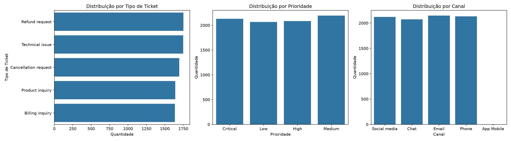
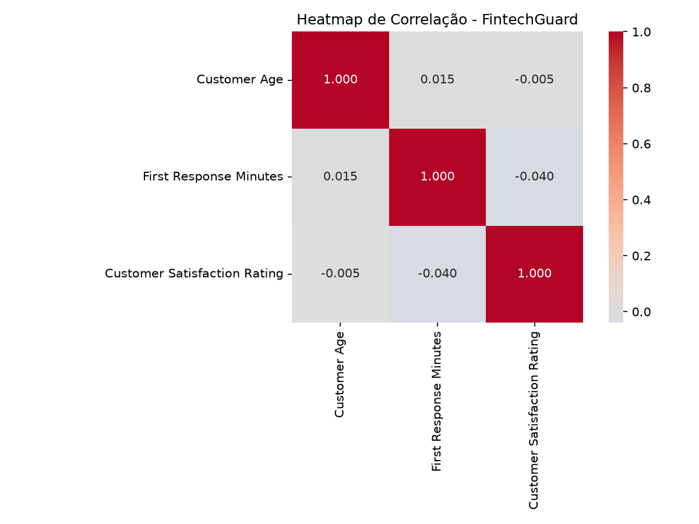
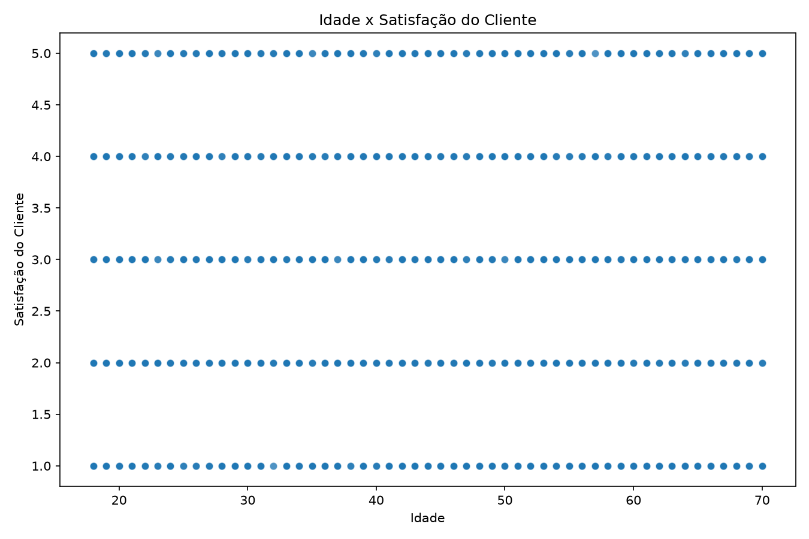
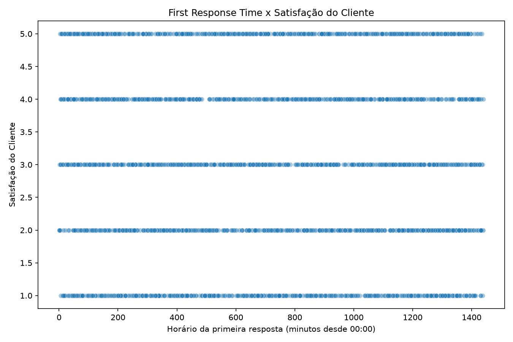
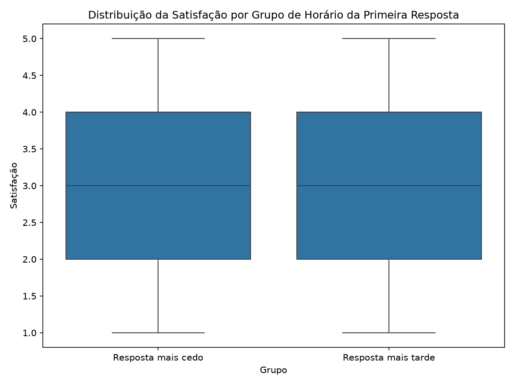

# FintechGuard — Relatório de Análise Exploratória de Dados (EDA)

## 1. Objetivo

Este relatório documenta a análise exploratória de dados (EDA) realizada sobre o conjunto de dados **Customer Support Tickets**, com foco na qualidade dos dados, distribuição dos tipos de tickets, análise de variáveis numéricas, correlações e investigação da relação entre o tempo de primeira resposta e a satisfação do cliente.

Dataset: [Customer Support Ticket Dataset — Kaggle](https://www.kaggle.com/datasets/suraj520/customer-support-ticket-dataset)

Licença informada: Apache 2.0.

## 2. Tecnologias utilizadas

- Python
- Pandas
- NumPy
- Matplotlib
- Seaborn
- SciPy

## 3. Visão geral dos dados

O arquivo original apresentou **8.484 linhas e 20 colunas**. Entre as colunas identificadas estavam idade do cliente, tipo e prioridade do ticket, canal de atendimento, tempo da primeira resposta e avaliação de satisfação.

A inspeção inicial identificou três colunas sem valores preenchidos (`Unnamed: 17`, `Unnamed: 18` e `Unnamed: 19`), além de valores ausentes em campos relacionados à resolução dos tickets, ao tempo de primeira resposta e à satisfação.

### 3.1 Limpeza dos dados

Durante o processamento, foram identificados e tratados:

- 3 linhas completamente vazias;
- 1 registro duplicado removido;
- 7 registros classificados pelo script como anomalias estruturais e removidos da análise;
- categorias textuais normalizadas, incluindo `Cobrança` para `Billing inquiry` e `Suporte Técnico` para `Technical issue`.

Ao final do processamento, **8.473 registros foram utilizados na análise**.

O script também identificou 8 tickets contendo conteúdo potencialmente suspeito, incluindo padrões semelhantes a HTML ou JavaScript. Esses registros foram sinalizados para inspeção. A presença desses padrões, isoladamente, não comprova uma tentativa de ataque.

Os registros classificados como anômalos são exportados para `data/customer_support_tickets_anomalies.csv`.

## 4. Estatísticas descritivas

### 4.1 Idade dos clientes

| Estatística | Valor |
|---|---:|
| Média | 44,02 anos |
| Desvio padrão | 15,30 anos |
| Mínimo | 18 anos |
| Mediana | 44 anos |
| Máximo | 70 anos |

### 4.2 Satisfação dos clientes

A avaliação de satisfação apresentou os seguintes resultados:

| Estatística | Valor |
|---|---:|
| Média | 2,99 |
| Desvio padrão | 1,41 |
| Mínimo | 1 |
| Mediana | 3 |
| Máximo | 5 |

A média próxima de 3 indica uma avaliação central próxima ao ponto intermediário da escala utilizada. A interpretação deve considerar a distribuição das avaliações e a quantidade de registros disponíveis para essa variável.

## 5. Distribuição dos tipos de tickets

Após a normalização das categorias, a distribuição foi:

| Tipo de ticket | Quantidade |
|---|---:|
| Refund request | 1.752 |
| Technical issue | 1.750 |
| Cancellation request | 1.695 |
| Product inquiry | 1.641 |
| Billing inquiry | 1.635 |
| **Total** | **8.473** |

Os cinco tipos de tickets apresentam quantidades relativamente próximas, sem uma categoria que concentre, isoladamente, a maior parte dos registros.

## 6. Tratamento do tempo da primeira resposta

A coluna `First Response Time` foi convertida para um formato de data e hora, permitindo extrair o horário e representá-lo em minutos desde a meia-noite.

O processamento converteu **5.650 valores** com sucesso.

**Limitação importante:** essa transformação representa o horário do dia em que a primeira resposta ocorreu, e não necessariamente o tempo decorrido entre a abertura do ticket e a resposta. Portanto, os resultados não devem ser interpretados diretamente como duração do atendimento.

## 7. Análise de correlação

As correlações calculadas pelo script foram:

| Variáveis | Correlação |
|---|---:|
| Idade × Minutos da primeira resposta | 0,015 |
| Idade × Satisfação | -0,005 |
| Minutos da primeira resposta × Satisfação | -0,040 |

Os coeficientes estão próximos de zero, indicando associações lineares fracas entre os pares de variáveis avaliados nesta análise.

Correlação não implica causalidade, e uma correlação linear fraca não exclui a possibilidade de outras relações entre as variáveis.

## 8. Teste de hipótese — Mann–Whitney U

Foi aplicado o teste não paramétrico de Mann–Whitney U para comparar as distribuições das avaliações de satisfação entre dois grupos definidos pela mediana do horário da primeira resposta.

### 8.1 Configuração do teste

| Indicador | Resultado |
|---|---:|
| Mediana do horário | 710,20 minutos |
| Grupo de resposta mais cedo | 1.385 registros |
| Grupo de resposta mais tarde | 1.384 registros |
| Mediana de satisfação — grupo mais cedo | 3,00 |
| Mediana de satisfação — grupo mais tarde | 3,00 |
| Estatística U | 994.174,50 |
| Valor-p | 0,082766 |
| Nível de significância (α) | 0,05 |

### 8.2 Hipóteses

- **H₀:** as distribuições de satisfação dos dois grupos não diferem.
- **H₁:** as distribuições de satisfação dos dois grupos diferem.

### 8.3 Resultado e interpretação

Como o valor-p de **0,082766 é superior a 0,05**, não rejeitamos a hipótese nula ao nível de significância de 5%.

Assim, **não há evidência estatística suficiente para afirmar que as distribuições de satisfação diferem entre os grupos analisados**.

Esse resultado não comprova que os grupos sejam equivalentes. Além disso, como os grupos foram definidos pelo horário do dia, e não pelo tempo decorrido até a primeira resposta, o teste não permite concluir diretamente que responder mais rapidamente aumenta a satisfação do cliente.

## 9. Arquivos relacionados

| Arquivo | Finalidade |
|---|---|
| `scripts/eda.py` | Implementação do processamento e das análises |
| `data/customer_support_tickets.csv` | Dataset original |
| `data/customer_support_tickets_cleaned.csv` | Dataset limpo disponível no projeto |
| `data/customer_support_tickets_anomalies.csv` | Registros sinalizados como anômalos pelo script |
| `graphs/eda_visualizations.png` | Visualizações gerais |
| `graphs/heatmap_correlacao.png` | Matriz de correlação |
| `graphs/scatter_idade_satisfacao.png` | Dispersão entre idade e satisfação |
| `graphs/scatter_resposta_satisfacao.png` | Dispersão entre horário e satisfação |
| `graphs/boxplot_resposta_satisfacao.png` | Comparação da satisfação entre grupos |

## 10. Conclusão

A análise exploratória permitiu avaliar a estrutura do conjunto de dados, tratar registros vazios, duplicados e anomalias estruturais, padronizar categorias e investigar relações entre características dos clientes, horários de resposta e satisfação.

As correlações observadas foram fracas. O teste de Mann–Whitney não encontrou evidência estatística suficiente, ao nível de 5%, de diferença entre as distribuições de satisfação dos grupos comparados.

Os resultados também evidenciam uma limitação relevante: a variável utilizada representa o horário da primeira resposta, não necessariamente o tempo real de espera. Uma investigação futura deve considerar uma medida de duração calculada a partir dos horários de abertura e resposta dos tickets, caso essas informações estejam disponíveis.

A EDA estabelece, assim, uma base documentada para as próximas etapas de análise e modelagem do FintechGuard.